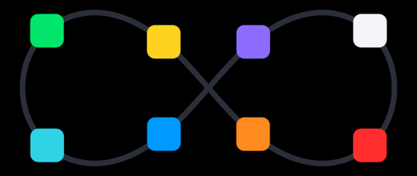

# OP-8

<p align="center"></p>

A standalone groovebox in Rust for the **Raspberry Pi 4/5** (developed and tested on **macOS Apple Silicon**) that uses a **Native Instruments Maschine MK3** as its only control surface: pads, knobs, Smart Strip, LEDs and the two 480×272 screens.

The sequencer is inspired by the OP-XY: per-track polymeter, stackable *Step Components*, a harmony track (*Brain*) and *Punch-in FX*. Instruments are **cartridges** that implement a single trait and know nothing about the sequencer or the hardware.

## Get it and try it

You need a stable Rust (`rustup`) and a C++ compiler, because the macro instrument compiles the Plaits code: on macOS `xcode-select --install` is enough; on Linux or the Pi, `sudo apt install build-essential libasound2-dev`.

```sh
git clone https://github.com/jsrxar77/op-3.git
cd op-3
cargo test --workspace                       # everything, no hardware needed
cargo run --release -- sim -s 8              # simulated MK3: writes out/out.wav and .ppm captures of both screens
cargo run --release -- sim --script my.op8   # the same with your own script (see below); prints the loudness every 0.5 s
cargo run --release -- run --script my.op8   # the script drives the real app: you hear and see it on the MK3
cargo run --release -- hw-test               # with the real MK3: rainbow on the 16 pads + a test frame on both screens + event log
cargo run --release                          # play with the MK3 (audio, screens, LEDs, MIDI)
scripts/run.sh                               # the same in one command: builds, frees the MK3 from NI's services, starts (-h for options)
cargo run --release -- -t chrome              # another theme: glossy (default), matte, chrome
```

On macOS, close NI's services first (`NIHardwareAgent`, `NIHostIntegrationAgent`, `NTKDaemon`): if they hold USB interface 5, OP-8 keeps working but without screens, and says so on the console. On Linux install `deploy/99-maschine-mk3.rules` to avoid needing root.

**User guide:** `open guide/index.html` (interactive, no server; it becomes a site with GitHub Pages, see [architecture.md](docs/architecture.md)).

The interactive twin in HTML (`twin/op8-twin.html`) reproduces the two screens, the pads and the knobs with sound in WebAudio and opens in Safari or Chrome, even on the iPad: just open the file, no server needed.

**To continue the work** (person or AI): start with [docs/architecture.md](docs/architecture.md) and [docs/roadmap.md](docs/roadmap.md).

**Documents.** `docs/` has six: [architecture](docs/architecture.md) (how it is built, decisions, how to build and test), [design](docs/design.md) (the UX/UI treatise: eight encoders with eight colours, absolute black, drawings instead of text, one typeface), [buttons](docs/buttons.md) (what each button does), [instruments](docs/instruments.md) (the centre of OP-8), [features](docs/features.md) (the verifiable behaviours and their tests) and [roadmap](docs/roadmap.md) (status and order of work).

Screenshots of the simulator (step, inspector, Brain, Punch FX, end), generated with `op8 sim`:


## Scripts: testing without hands

A script is a text file with one action per line (`<seconds> <command>`), which plays the part of a hand on the MK3. The example is `crates/op8/scripts/demo.op8`.

```text
0.1  btn play
1.0  btn group b            # groups a..h
1.0  touch 5 on             # knobs 0..7 from left to right
1.0  knob 5 150             # turn (1000 per turn)
2.0  pad 14 strike 0.7      # pads 0..15; strike [vel] | press | pressure v | release
3.0  btn screen 6           # the buttons above the screens, 1..8
4.0  btn mute down          # down / up to hold a button
4.0  btn group a
4.1  btn mute up
5.0  strip 0.25             # Smart Strip, or `strip off`
6.0  shot macro             # sim only: saves macro-left.ppm and macro-right.ppm
```

With `sim` no hardware is needed: it writes `out.wav`, the captures and a table of RMS and peak per stretch to check what sounds and when. With `run` the same events enter the real app and you hear them on the MK3. The same mechanism drives the test bench (`crates/op8/src/bench.rs`) behind the feature cases in [docs/features.md](docs/features.md).

## Architecture

```text
                        ┌─────────────── control/UI thread (60 fps) ────────────────┐
 Maschine MK3 ──HID────▶│ op8-hw ─ControlEvent─▶ Controller ─EngineCommand─┐         │
   (or MockSurface)     │                          │  UiState               │         │
                ◀─LEDs──│                          ▼                        │         │
                        │ DirtyTracker ◀─ op8-ui (left / right screen)      │         │
                        └───────────────────────────────────────────────────┼─────────┘
              screens: a thread of their own (row bands, compressed)  rtrb (lock-free)
                        ┌──────────────── audio thread (cpal, 48 kHz) ──────▼─────────┐
                        │ Engine: Sequencer → NoteEvents → 8 × InstrumentCartridge     │
                        │         → mix → Punch-in FX → Smart Strip filter → output    │
                        │         publishes playheads / chord / levels in atomics      │
                        └──────────────────────────────────────────────────────────────┘
```

| crate | what it does | depends on |
|---|---|---|
| `op8-gfx` | `Rgb565`, `FrameBuffer480x272` (implements embedded-graphics' `DrawTarget`), primitives, `DirtyTracker` | – |
| `op8-cartridge` | the `InstrumentCartridge` contract, plus `NoteEvent`, `ParamDescriptor`, etc. | gfx |
| `op8-seq` | deterministic sequencer: steps, components, Brain, clock, command model | cartridge (only `NoteEvent`) |
| `op8-engine` | audio engine: sequencer + 8 slots + mix + Punch-in FX + command queue | seq, cartridge |
| `op8-plaits` | the macro oscillator from Plaits (C++, MIT, unchanged) behind a Rust interface; 24 engines | – |
| `op8-cartridges` | **KickSyn**, **FmBass**, **MidiOutBridge**, **macro**, **drums** | cartridge, plaits |
| `op8-hw` | `ControlSurface` trait, `MockSurface`, MK3 protocol (pure functions) and USB transport (feature `mk3`) | gfx |
| `op8-ui` | layouts of the left and right screens | gfx, seq, engine |
| `op8` | binary: controller, frame loop, cpal audio, MIDI output, simulator, `hw-test`, test bench | everything |

The sequencer and the cartridges **do not depend on any driver**. Hardware enters only through `op8-hw` and the binary. The full description is in [docs/architecture.md](docs/architecture.md).

### Sequencer

* **Tick clock** (96 PPQN) placed at exact sample positions. Each track's playhead is `(tick / ticks_per_step) % length`, a pure function of the global tick, so the polymeter cannot drift: lengths 3 and 4 coincide again exactly every 12 steps. Tests check that the result is identical with blocks of 64 or of 1000 frames.
* **Polymeter** of 1 to 16 steps per track, with a per-track division (1/32, 1/16T, 1/16, 1/8, 1/4) and global swing.
* **Stackable Step Components**, up to 6 per step, each with its own combining rule: `Ratchet` (multiplies), `Chance` (multiplies probabilities), `Every n:m` (all must hold), `Velocity`/`Transpose`/`Octave`/`Hold`/`Delay`/`RandomNote` (add), `ParamLock` (the last wins; restored on the next step).
* **Brain**: key, scale (7 modes), a progression of up to 8 chords with a duration in steps, and a *live* chord from the pads. Linked tracks write their notes relative to C; they are transposed by the chord root (by the shortest way) and fitted to a chord note, a scale note, or only transposed.
* **Deterministic**: randomness uses a PRNG seeded per track and re-seeded on every Play. Same project, same output, to the sample.
* **No memory allocation** on the audio thread: fixed-size queues.

### Cartridges

The trait has six mandatory methods and **optional methods with a default implementation** (`secondary_parameters`, `parameter_value`, `all_notes_off`), so a cartridge that implements only the mandatory ones compiles anyway.

* **drums**: eight percussion sounds on one track, chosen by the pitch of the note (C kick, C# snare, D closed hat, D# open hat, E tom, F clap, F# rim, G crash). Demo track A.
* **KickSyn**: a sine with a pitch sweep, a noise click and drive. The screen shows amplitude and pitch envelopes and an oscilloscope.
* **FmBass**: 2-operator FM, monophonic with last-note priority, glide and a sub-oscillator. The screen shows the MOD→CAR topology, ADSR and an oscilloscope.
* **macro**: 24 synthesis engines (analogue, FM, wavetable, chords, voice, strings, modal, percussion) from Mutable Instruments' Plaits code (MIT). Four sound knobs (engine, harmonics, timbre, morph) and four shape knobs (decay, color, variant, level).
* **MidiOutBridge**: generates no audio. It converts notes to MIDI (channel, transposition, CC74) towards the MK3's DIN MIDI (ALSA rawmidi on Linux, CoreMIDI on macOS).

To add an instrument: a new crate or module that implements `InstrumentCartridge`, loaded into a slot with `EngineHandle::load_cartridge`. The sequencer and the drivers do not need to be touched. The real-time rules are documented on the trait; the rules for an instrument are in [docs/instruments.md](docs/instruments.md).

### MK3 hardware

* **HID** (interface 4): buttons, 8 endless knobs, 4D encoder, Smart Strip, pads with velocity and pressure. LEDs in two reports (`0x80`, `0x81`). On Linux `/dev/hidrawN` is read directly; on macOS `hidapi` (IOKit) is used.
* **Screens** (interface 5, bulk `0x04`) with `nusb` (pure Rust), from a thread of their own: only the rows that changed are sent, always full width, with repeated pixel pairs compressed, plus a full refresh every 500 ms. `OP8_DISPLAY_STATS=1` prints the figures.
* The protocol is our own implementation. **No code from Encdr, autotel or Deckard was used**: they are GPL and depending on them would force OP-8 to be GPL too. Protocol facts have no copyright; code does.
* All parsing and encoding are pure functions with tests (pads and their ordering quirks, knobs that wrap around, the free-running counter of analog field 0, the screen transfer format with a reference reader).

### Raspberry Pi

* `scripts/build-pi.sh [pi@host]`: cross-compilation with `cross` for `aarch64-unknown-linux-gnu` and, if given a host, installs and restarts.
* `deploy/pi-setup.sh`: creates the `op8` user, installs the udev rules, the real-time limits and the `performance` governor, boots to the console without a desktop and enables `deploy/op8.service`.
* `deploy/op8.service`: direct start, automatic restart, a 64-frame buffer (`OP8_BUFFER`), `LimitRTPRIO`, affinity to cores 1–3.
* On the Pi it can be compiled natively with `cargo build --release` (`libasound2-dev` is needed).

## Controls

| control | STEP mode | BRAIN mode | PUNCH FX mode |
|---|---|---|---|
| pad (tap) | toggle step (step 1 = top-left pad) | *live* chord while held | momentary effect |
| pad held > 300 ms | Step Components inspector | – | – |
| pad pressure | – | – | effect intensity |
| Groups A–H | select track | | |
| Shift + Group / Mute + Group | link to the Brain / mute | | |
| Erase + pad | erase step | | |
| knobs 1–4 | length · division · swing · BPM (inspector: note · velocity · gate · component) | key · scale · mode · number of chords | – · – · – · BPM |
| knobs 5–8 | instrument parameters (screen buttons 5/6 change page) | | |
| 4D encoder | BPM (Shift = fine); in the inspector it picks the component slot | | |
| Smart Strip | master filter: left half low-pass, right half high-pass | | |
| Step / Chords / Perform | change mode | | |

Punch-in FX pads (from bottom left): LPF, HPF, CRUSH, DOWNSMP · GATE16, GATE8, TAPESTOP, KILL · RPT 1/4, 1/8, 1/16, 1/32 · RPT 1/16T, STUT 1/16, STUT 1/32, ECHO. The `RPT` are *beat repeat* in the sequencer; the rest are audio effects on the master bus. What every button does is in [docs/buttons.md](docs/buttons.md).

## Status and what is unverified on hardware

Status, hardware status and the next steps are kept in [docs/roadmap.md](docs/roadmap.md). In short: the screens, the colour order and the buttons have been checked on a real MK3; the LED palette beyond red and orange and the CPU load on the Pi 5 have not.

## Licence

MIT or Apache-2.0, at your choice. The code in `crates/op8-plaits/vendor` is by Mutable Instruments (MIT, see its `README.md` and licences); OP-8 does not use their module names.
