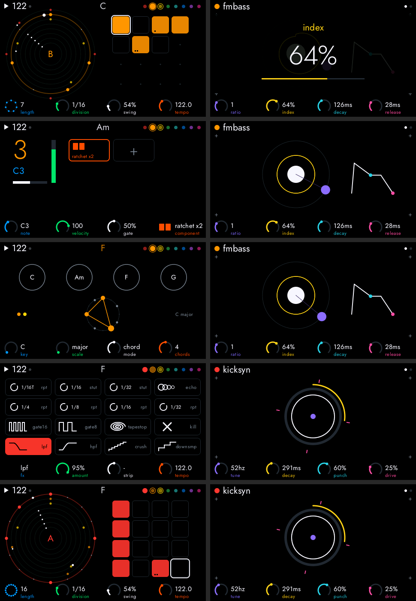

# OP-3

Groovebox standalone en Rust para **Raspberry Pi 4/5** (desarrollo y pruebas en **macOS Apple Silicon**) que usa una **Native Instruments Maschine MK3** como única superficie de control: pads, perillas, Smart Strip, LEDs y las dos pantallas de 480×272.

El secuenciador está inspirado en el OP-XY: polimetría por pista, *Step Components* acumulables, una pista de armonía (*Brain*) y *Punch-in FX*. Los instrumentos son **cartuchos** que implementan un único trait y no saben nada del secuenciador ni del hardware.

## Probarlo

```sh
cargo test --workspace                  # 72 tests, no hace falta hardware
cargo run --release -- sim -s 8         # MK3 simulada: escribe out/out.wav y capturas .ppm de ambas pantallas
cargo run --release -- hw-test          # Fase 1 con la MK3 real: arcoíris en los 16 pads + frame de prueba en ambas pantallas + log de eventos
cargo run --release                     # tocar con la MK3 (audio, pantallas, LEDs, MIDI)
```

En macOS, cerrá antes los servicios de NI (`NIHardwareAgent`): si tienen tomada la interfaz USB 5, OP-3 sigue funcionando pero sin pantallas, y avisa por consola. En Linux instalá `deploy/99-maschine-mk3.rules` para no necesitar root.

El gemelo interactivo en HTML (`docs/op3-twin.html`) reproduce las dos pantallas, los pads y las perillas con sonido en WebAudio y se abre en Safari o Chrome, incluso en el iPad.

**Diseño:** todas las pantallas y controles siguen el [Tratado de UX/UI](docs/DESIGN.md); qué hace cada botón está en [docs/BOTONES.md](docs/BOTONES.md), los instrumentos (el centro de OP-3) en [docs/INSTRUMENTOS.md](docs/INSTRUMENTOS.md) y el orden de trabajo en [docs/ROADMAP.md](docs/ROADMAP.md). Es la regla de la app: ocho encoders con ocho colores (1–4 secuenciador, 5–8 instrumento), negro absoluto, dibujos en vez de texto, una sola letra.

Capturas del simulador (paso, inspector, Brain, Punch FX, final), generadas con `op3 sim`:



## Arquitectura

```text
                        ┌─────────────── hilo de control/UI (60 fps) ───────────────┐
 Maschine MK3 ──HID────▶│ op3-hw ─ControlEvent─▶ Controller ─EngineCommand─┐         │
   (o MockSurface)      │                          │  UiState               │         │
                ◀─LEDs──│                          ▼                        │         │
                ◀─bulk──│ DirtyTracker ◀─ op3-ui (pantalla izq. / der.)     │         │
                        └───────────────────────────────────────────────────┼─────────┘
                                                              rtrb (lock-free)
                        ┌──────────────── hilo de audio (cpal, 48 kHz) ─────▼─────────┐
                        │ Engine: Sequencer → NoteEvents → 8 × InstrumentCartridge     │
                        │         → mezcla → Punch-in FX → filtro Smart Strip → salida │
                        │         publica playheads / acorde / niveles en atómicos     │
                        └──────────────────────────────────────────────────────────────┘
```

| crate | qué hace | depende de |
|---|---|---|
| `op3-gfx` | `Rgb565`, `FrameBuffer480x272` (implementa `DrawTarget` de embedded-graphics), primitivas, `DirtyTracker` | – |
| `op3-cartridge` | el contrato `InstrumentCartridge` exactamente como en el handover, más `NoteEvent`, `ParamDescriptor`, etc. | gfx |
| `op3-seq` | secuenciador determinista: pasos, componentes, Brain, reloj, modelo de comandos | cartridge (sólo `NoteEvent`) |
| `op3-engine` | motor de audio: secuenciador + 8 slots + mezcla + Punch-in FX + cola de comandos | seq, cartridge |
| `op3-cartridges` | **KickSyn**, **FmBass**, **MidiOutBridge** | cartridge |
| `op3-hw` | trait `ControlSurface`, `MockSurface`, protocolo MK3 (funciones puras) y transporte USB (feature `mk3`) | gfx |
| `op3-ui` | layouts de pantalla izquierda y derecha | gfx, seq, engine |
| `op3` | binario: controlador, bucle de frames, audio cpal, salida MIDI, simulador, `hw-test` | todo |

El secuenciador y los cartuchos **no dependen de ningún driver**. El hardware entra sólo por `op3-hw` y el binario.

### Secuenciador (Fase 2)

* **Reloj por ticks** (96 PPQN) colocados en posiciones exactas de sample. El playhead de cada pista es `(tick / ticks_por_paso) % largo`, una función pura del tick global, así que la polimetría no puede derivar: largos 3 y 4 vuelven a coincidir exactamente cada 12 pasos. Hay tests que comprueban que el resultado es idéntico con bloques de 64 o de 1000 frames.
* **Polimetría** de 1 a 16 pasos por pista, con división por pista (1/32, 1/16T, 1/16, 1/8, 1/4) y swing global.
* **Step Components acumulables**, hasta 6 por paso, cada uno con su regla de suma: `Ratchet` (multiplica), `Chance` (multiplica probabilidades), `Every n:m` (todas deben cumplirse), `Velocity`/`Transpose`/`Octave`/`Hold`/`Delay`/`RandomNote` (suman), `ParamLock` (el último gana; se restaura en el paso siguiente).
* **Brain**: tonalidad, escala (7 modos), progresión de hasta 8 acordes con duración en pasos, y acorde *live* desde los pads. Las pistas enlazadas escriben sus notas relativas a Do; se transponen por la raíz del acorde (por el camino más corto) y se ajustan a nota del acorde, a nota de la escala o sólo se transponen.
* **Determinista**: lo aleatorio usa un PRNG sembrado por pista y se re-siembra en cada Play. Mismo proyecto, misma salida, al sample.
* **Sin asignaciones de memoria** en el hilo de audio: colas de tamaño fijo.

### Cartuchos (Fase 3)

El trait es el del handover. Los seis métodos obligatorios no cambiaron. Se agregaron métodos **opcionales con implementación por defecto** (`secondary_parameters`, `parameter_value`, `all_notes_off`), así que un cartucho que implemente sólo lo del handover compila igual.

* **KickSyn**: seno con barrido de pitch, click de ruido y drive. Pantalla con envolventes de amplitud y pitch y osciloscopio.
* **FmBass**: FM de 2 operadores, monofónico con prioridad a la última nota, glide y sub-oscilador. Pantalla con la topología MOD→CAR, ADSR y osciloscopio.
* **MidiOutBridge**: no genera audio. Convierte notas en MIDI (canal, transposición, CC74) hacia el DIN MIDI de la MK3 (ALSA rawmidi en Linux, CoreMIDI en macOS).

Para sumar un instrumento: un crate o módulo nuevo que implemente `InstrumentCartridge`, y cargarlo en un slot con `EngineHandle::load_cartridge`. No hace falta tocar el secuenciador ni los drivers. Las reglas de tiempo real están documentadas en el trait.

### Hardware MK3 (Fase 1)

* **HID** (interfaz 4): botones, 8 perillas sin fin, encoder 4D, Smart Strip, pads con velocidad y presión. LEDs en dos reportes (`0x80`, `0x81`). En Linux se lee `/dev/hidrawN` directamente; en macOS se usa `hidapi` (IOKit).
* **Pantallas** (interfaz 5, bulk `0x04`) con `nusb` (Rust puro). Sólo se envían los rectángulos que cambiaron: en el simulador, el 3% de los píxeles de enviar ambas pantallas completas a 60 fps.
* El protocolo es una implementación propia basada en `autotel/maschine-mk3-linux/docs/protocol.md` y `hardware-map.md`. **No se usó Encdr ni código de autotel**: ambos son GPL-3.0 y depender de ellos obligaría a que OP-3 también lo sea. Los hechos del protocolo no tienen copyright; el código sí.
* Todo el parseo y la codificación son funciones puras con tests (pads con sus rarezas de orden, perillas que dan la vuelta, el contador libre del campo analógico 0, formato de transferencia de pantalla).

### Raspberry Pi (Fase 4)

* `scripts/build-pi.sh [pi@host]`: compilación cruzada con `cross` para `aarch64-unknown-linux-gnu` y, si se le pasa host, instala y reinicia.
* `deploy/pi-setup.sh`: crea el usuario `op3`, instala las reglas udev, los límites de tiempo real, el governor `performance`, arranca en consola sin escritorio y habilita `deploy/op3.service`.
* `deploy/op3.service`: arranque directo, reinicio automático, buffer de 64 frames (`OP3_BUFFER`), `LimitRTPRIO`, afinidad a núcleos 1–3.
* En la Pi se puede compilar nativamente con `cargo build --release` (hace falta `libasound2-dev`).

## Controles

| control | modo STEP | modo BRAIN | modo PUNCH FX |
|---|---|---|---|
| pad (toque) | activar/desactivar paso (paso 1 = pad superior izquierdo) | acorde *live* mientras se mantiene | efecto momentáneo |
| pad mantenido > 300 ms | inspector de Step Components | – | – |
| presión del pad | – | – | intensidad del efecto |
| Grupos A–H | seleccionar pista | | |
| Shift + Grupo / Mute + Grupo | enlazar al Brain / mutear | | |
| Erase + pad | borrar paso | | |
| perillas 1–4 | largo · división · swing · BPM (inspector: nota · velocity · gate · componente) | tonalidad · escala · modo · cantidad de acordes | – · – · – · BPM |
| perillas 5–8 | parámetros del instrumento (Screen 5/6 cambian de página) | | |
| encoder 4D | BPM (Shift = fino); en el inspector elige el slot de componente | | |
| Smart Strip | filtro master: mitad izquierda pasa-bajos, mitad derecha pasa-altos | | |
| Step / Chords / Perform | cambian de modo | | |

Pads del Punch-in FX (desde abajo a la izquierda): LPF, HPF, CRUSH, DOWNSMP · GATE16, GATE8, TAPESTOP, KILL · RPT 1/4, 1/8, 1/16, 1/32 · RPT 1/16T, STUT 1/16, STUT 1/32, ECHO. Los `RPT` son *beat repeat* en el secuenciador; el resto son efectos de audio en el bus master.

## Supuestos y cosas sin verificar en hardware

Esto compila y pasa los tests, pero **nada se probó todavía con una MK3 real**. Lo que hay que mirar con `op3 hw-test`:

1. **Formato de pantalla**: se usó el de autotel (`02 00 00 00` + largo u32). Encdr usa otro (`00` + contador de 24 bits, con RLE `01`). Si la imagen sale mal, es lo primero a cambiar (`op3-hw/src/mk3/protocol.rs`, `encode_screen`).
2. **Orden de colores**: RGB565 big-endian con rojo en los bits altos. En el frame de prueba la primera barra tiene que verse **roja**.
3. **Paleta de LEDs**: sólo rojo (1) y naranja (2) están confirmados. El resto de `NiColor` sigue el orden de tonos habitual de NI.
4. **macOS**: el código de `hidapi`, CoreAudio y CoreMIDI no se pudo compilar en este entorno (Linux). El job de macOS en CI lo verifica.
5. **Audio**: la MK3 expone 4 canales; L/R van a los canales 1/2 y se copian a los auriculares (3/4).

## Próximos pasos

* Probar la Fase 1 en la MK3 real y corregir lo de arriba.
* Parameter locks con precisión de sample (hoy se aplican al inicio del bloque, ≤ 2,7 ms antes).
* Snapshot triple-buffer de la UI del cartucho para que `draw_ui` nunca comparta el mutex con el audio.
* Prioridad de tiempo real para el hilo de audio en Linux (`audio_thread_priority`) y medir latencia en la Pi 5.
* MIDI con timestamps (hoy sale apenas se drena la cola, ≤ 1 ms + un bloque).
* Guardar/cargar proyectos y presets (`save_state` ya existe en los cartuchos).
* Escribir acordes en la progresión del Brain desde los pads (hoy los pads sólo tocan acordes *live*).
* Más cartuchos (sampler, `fundsp`, Faust).

## Licencia

MIT o Apache-2.0, a elección.
