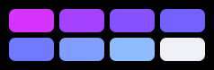
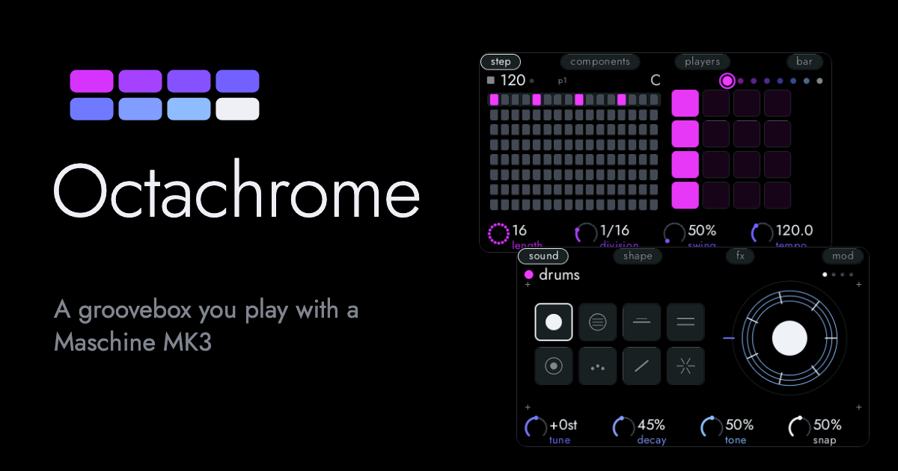
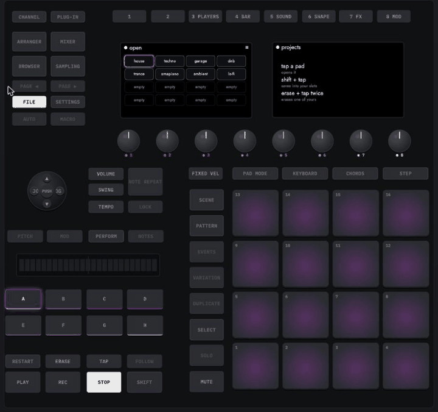
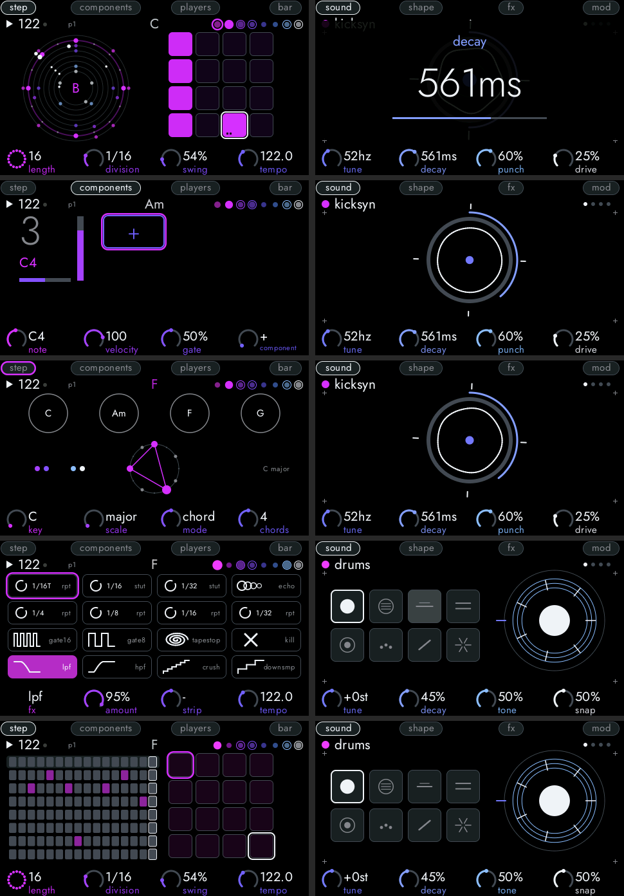

# Octachrome

<p align="center"></p>

<p align="center">
  <a href="https://github.com/jsrxar77/octachrome/actions/workflows/ci.yml"></a>
  <a href="#licence"></a>
</p>

<p align="center">
  <b><a href="https://jsrxar77.github.io/octachrome/">Home</a></b> ·
  <b><a href="https://jsrxar77.github.io/octachrome/twin/octachrome-twin.html">Try it in the browser</a></b> ·
  <b><a href="https://jsrxar77.github.io/octachrome/manual.html">Manual</a></b> ·
  <b><a href="https://github.com/jsrxar77/octachrome-releases/releases/latest">Download</a></b> ·
  <b><a href="CHANGELOG.md">Changelog</a></b>
</p>

A standalone groovebox in Rust for the **Raspberry Pi 4/5** (developed and tested on **macOS Apple Silicon**) that uses a **Native Instruments Maschine MK3** as its only control surface: pads, knobs, Smart Strip, LEDs and the two 480×272 screens. No computer in the loop once it runs, and no hardware needed to try it: there is a simulator, a test bench and an interactive twin that runs in a browser.



**What is in it**

* A sequencer inspired by the OP-XY: per-track polymeter, stackable *Step Components* (ratchet, chance, every, velocity, parameter locks…), a harmony track (*Brain*) that puts the notes of every linked track on the chord, scenes and a song (ARRANGER), a mixer with a compressor, an EQ and two sends.
* Eight instruments that know nothing about the sequencer or the hardware (they are **cartridges** that implement one trait): drums, a kick, an FM bass, a plucked-string and bell resonator, a **sampler**, a **granular** cloud, a 24-engine macro oscillator (from Mutable Instruments' Plaits) and a MIDI out.
* **Eight whole songs that come with it**, each about two minutes and made as its style is made ([the list](#the-eight-songs), and [the mp3s](https://github.com/jsrxar77/octachrome-releases/releases/tag/v0.1.0) to listen to): house, techno, UK garage, drum & bass, trance, amapiano, ambient and lo-fi.
* Every screen, light and button of the MK3 has a job and is designed as one system ([docs/design.md](docs/design.md)): eight colours, absolute black, drawings instead of text, one typeface.

**Try it in a minute, with nothing connected:** [open the twin in your browser](https://jsrxar77.github.io/octachrome/twin/octachrome-twin.html) (or `twin/octachrome-twin.html` from a clone: no server, no install; it works on an iPad too), press FILE, a pad of the top row, and PLAY. The [manual](https://jsrxar77.github.io/octachrome/manual.html) explains every button, with pictures of the unit and tested recipes.



## Get it and try it

You need a stable Rust (`rustup`) and a C++ compiler, because the macro instrument compiles the Plaits code: on macOS `xcode-select --install` is enough; on Linux or the Pi, `sudo apt install build-essential libasound2-dev`.

```sh
git clone https://github.com/jsrxar77/octachrome.git
cd octachrome
cargo test --workspace                       # everything, no hardware needed
cargo run --release -- sim -s 8              # simulated MK3: writes out/out.wav and .ppm captures of both screens
cargo run --release -- sim --script my.ocs   # the same with your own script (see below); prints the loudness every 0.5 s
cargo run --release -- run --script my.ocs   # the script drives the real app: you hear and see it on the MK3
cargo run --release -- hw-test               # with the real MK3: rainbow on the 16 pads + a test frame on both screens + event log
cargo run --release                          # play with the MK3 (audio, screens, LEDs, MIDI)
scripts/run.sh                               # the same in one command: builds, frees the MK3 from NI's services, starts (-h for options)
cargo run --release -- -t matte               # another theme: chrome (default), matte, glossy
```

On macOS, close NI's services first (`NIHardwareAgent`, `NIHostIntegrationAgent`, `NTKDaemon`): if they hold USB interface 5, Octachrome keeps working but without screens, and says so on the console. On Linux install `deploy/99-maschine-mk3.rules` to avoid needing root.

**Listen to the eight songs without hardware** (writes `out/song-N-name.wav`, a few seconds in a release build):

```sh
OCTACHROME_BENCH_DIR=$PWD/out cargo test --release -p octachrome --test songs
```

**Guide and manual:** `python3 scripts/build-site.py && open site/index.html` (static, no server). The same site is published with GitHub Pages: [jsrxar77.github.io/octachrome](https://jsrxar77.github.io/octachrome).

The interactive twin in HTML (`twin/octachrome-twin.html`) reproduces the two screens, the pads and the knobs with sound in WebAudio and opens in Safari or Chrome, even on the iPad: just open the file, no server needed.

**To continue the work** (person or AI): start with [docs/architecture.md](docs/architecture.md) and [docs/roadmap.md](docs/roadmap.md).

**Documents.** `docs/` has six: [architecture](docs/architecture.md) (how it is built, decisions, how to build and test), [design](docs/design.md) (the UX/UI treatise: eight encoders with eight colours, absolute black, drawings instead of text, one typeface), [buttons](docs/buttons.md) (what each button does), [instruments](docs/instruments.md) (the centre of Octachrome), [features](docs/features.md) (the verifiable behaviours and their tests) and [roadmap](docs/roadmap.md) (status and order of work).

### The eight songs

They open from FILE (the top two rows of pads) and play by themselves from PLAY, with their scenes and chords; mute a track, turn a knob, take them apart. Each was voiced by rendering every track alone and measuring its level, brightness and pitch ([docs/instruments.md §9](docs/instruments.md)).

| # | Song | Tempo | In short |
| :-- | :-- | :-- | :-- |
| 1 | **house** | 122 | Deep Chicago house: electric-piano stabs on minor sevenths, a bass between the kicks, a hook, a build, a bar of breath, the drop |
| 2 | **techno** | 124 | Melodic techno in D minor: a rolling bass, an arpeggio whose filter opens in the build, a breakdown |
| 3 | **garage** | 132 | UK 2-step in F minor: the kick skips two and four, dragged hats, organ stabs, vocal chops |
| 4 | **dnb** | 174 | Liquid drum & bass: a two-step break, a reese, open pads, a harp melody in an echo |
| 5 | **trance** | 138 | Uplifting trance on Am F C G: a galloping bass, a sixteenth arpeggio, a lead, a gated pad |
| 6 | **amapiano** | 113 | The kick synth tuned to a note as the log drum, shakers, a jazzy piano |
| 7 | **ambient** | 70 | F Lydian, two-bar chords, a drifting cloud, a heartbeat, nothing hits hard |
| 8 | **lo-fi** | 80 | Lo-fi hip hop: a dusty kit, an electric piano that comes in after the beat, a guitar phrase |

Screenshots of the simulator (step, inspector, Brain, Punch FX, end), generated with `octachrome sim`:



## Scripts: testing without hands

A script is a text file with one action per line (`<seconds> <command>`), which plays the part of a hand on the MK3. The example is `crates/octachrome/scripts/demo.ocs`.

```text
0.1  btn play
1.0  btn group b            # groups a..h
1.0  touch 5 on             # knobs 0..7 from left to right
1.0  knob 5 150             # turn (1000 per turn)
2.0  pad 14 strike 0.7      # pads 0..15; strike [vel] | press | pressure v | release
3.0  btn screen 6           # the buttons above the screens, 1..8
4.0  btn mute down          # down / up to hold a button
4.0  btn group a
4.1  btn mute up
5.0  strip 0.25             # Smart Strip, or `strip off`
6.0  shot macro             # sim only: saves macro-left.ppm and macro-right.ppm
```

With `sim` no hardware is needed: it writes `out.wav`, the captures and a table of RMS and peak per stretch to check what sounds and when. With `run` the same events enter the real app and you hear them on the MK3. The same mechanism drives the test bench (`crates/octachrome/src/bench.rs`) behind the feature cases in [docs/features.md](docs/features.md).

## Architecture

```text
                        ┌─────────────── control/UI thread (60 fps) ────────────────┐
 Maschine MK3 ──HID────▶│ octachrome-hw ─ControlEvent─▶ Controller ─EngineCommand─┐         │
   (or MockSurface)     │                          │  UiState               │         │
                ◀─LEDs──│                          ▼                        │         │
                        │ DirtyTracker ◀─ octachrome-ui (left / right screen)      │         │
                        └───────────────────────────────────────────────────┼─────────┘
              screens: a thread of their own (row bands, compressed)  rtrb (lock-free)
                        ┌──────────────── audio thread (cpal, 48 kHz) ──────▼─────────┐
                        │ Engine: Sequencer → NoteEvents → 8 × InstrumentCartridge     │
                        │         → mix → Punch-in FX → Smart Strip filter → output    │
                        │         publishes playheads / chord / levels in atomics      │
                        └──────────────────────────────────────────────────────────────┘
```

| crate | what it does | depends on |
|---|---|---|
| `octachrome-gfx` | `Rgb565`, `FrameBuffer480x272` (implements embedded-graphics' `DrawTarget`), primitives, the typeface, the themes, `DirtyTracker` | – |
| `octachrome-cartridge` | the `InstrumentCartridge` contract, plus `NoteEvent`, `ParamDescriptor`, etc. | gfx |
| `octachrome-seq` | deterministic sequencer: steps, components, Brain, scenes and song, clock, command model | cartridge (only `NoteEvent`) |
| `octachrome-engine` | audio engine: sequencer + 8 slots + track effects and LFO + mixer, compressor, EQ and sends + command queue | seq, cartridge |
| `octachrome-plaits` | the macro oscillator from Plaits (C++, MIT, unchanged) behind a Rust interface; 24 engines | – |
| `octachrome-cartridges` | **drums**, **KickSyn**, **FmBass**, **resonator**, **sampler**, **granular**, **macro**, **MidiOutBridge**, and the presets | cartridge, plaits |
| `octachrome-hw` | `ControlSurface` trait, `MockSurface`, MK3 protocol (pure functions) and USB transport (feature `mk3`) | gfx |
| `octachrome-ui` | the layouts of the two screens (step, instrument, arranger, mixer, files, browser, sampling, settings) | gfx, seq, engine |
| `octachrome` | binary: controller, frame loop, cpal audio, MIDI in and out, simulator, `hw-test`, the test bench, the eight songs | everything |

The sequencer and the cartridges **do not depend on any driver**. Hardware enters only through `octachrome-hw` and the binary. The full description is in [docs/architecture.md](docs/architecture.md).

### Sequencer

* **Tick clock** (96 PPQN) placed at exact sample positions. Each track's playhead is `(tick / ticks_per_step) % length`, a pure function of the global tick, so the polymeter cannot drift: lengths 3 and 4 coincide again exactly every 12 steps. Tests check that the result is identical with blocks of 64 or of 1000 frames.
* **Polymeter** of 1 to 16 steps per track, with a per-track division (1/32, 1/16T, 1/16, 1/8, 1/4) and global swing.
* **Stackable Step Components**, up to 6 per step, each with its own combining rule: `Ratchet` (multiplies), `Chance` (multiplies probabilities), `Every n:m` (all must hold), `Velocity`/`Transpose`/`Octave`/`Hold`/`Delay`/`RandomNote` (add), `ParamLock` (the last wins; restored on the next step).
* **Brain**: key, scale (7 modes), a progression of up to 8 chords with a duration in steps, and a *live* chord from the pads. Linked tracks write their notes relative to C; they are transposed by the chord root (by the shortest way) and fitted to a chord note, a scale note, or only transposed.
* **Deterministic**: randomness uses a PRNG seeded per track and re-seeded on every Play. Same project, same output, to the sample.
* **No memory allocation** on the audio thread: fixed-size queues.

### Cartridges

The trait has six mandatory methods and **optional methods with a default implementation** (`secondary_parameters`, `parameter_value`, `all_notes_off`), so a cartridge that implements only the mandatory ones compiles anyway.

* **drums**: eight percussion sounds on one track, chosen by the pitch of the note (C kick, C# snare, D closed hat, D# open hat, E tom, F clap, F# rim, G crash); each keeps its own tune, decay, tone, snap, body, level and pan.
* **resonator**: plucked strings and struck bells, four voices, built on the Plaits string and modal engines.
* **KickSyn**: a sine with a pitch sweep, a noise click and drive. The screen shows amplitude and pitch envelopes and an oscilloscope.
* **FmBass**: 2-operator FM, monophonic with last-note priority, glide and a sub-oscillator. The screen shows the MOD→CAR topology, ADSR and an oscilloscope.
* **macro**: 24 synthesis engines (analogue, FM, wavetable, chords, voice, strings, modal, percussion) from Mutable Instruments' Plaits code (MIT). Four sound knobs (engine, harmonics, timbre, morph) and four shape knobs (decay, color, variant, level).
* **sampler**: plays sounds from the keyboard and the steps: eight that come with it (made by the code, the pitched ones on a C, so a note plays that note) and eight for your own WAV files; one shot, loop, slices or hits; SAMPLING records what Octachrome plays or the audio input into it.
* **granular**: plays a sound of the sampler as a cloud of grains (position, size, density, tune, texture, spread).
* **MidiOutBridge**: generates no audio. It converts notes to MIDI (channel, transposition, CC74) towards the MK3's DIN MIDI (ALSA rawmidi on Linux, CoreMIDI on macOS).

To add an instrument: a new crate or module that implements `InstrumentCartridge`, loaded into a slot with `EngineHandle::load_cartridge`. The sequencer and the drivers do not need to be touched. The real-time rules are documented on the trait; the rules for an instrument are in [docs/instruments.md](docs/instruments.md).

### MK3 hardware

* **HID** (interface 4): buttons, 8 endless knobs, 4D encoder, Smart Strip, pads with velocity and pressure. LEDs in two reports (`0x80`, `0x81`). On Linux `/dev/hidrawN` is read directly; on macOS `hidapi` (IOKit) is used.
* **Screens** (interface 5, bulk `0x04`) with `nusb` (pure Rust), from a thread of their own: only the rows that changed are sent, always full width, with repeated pixel pairs compressed, plus a full refresh every 500 ms. `OCTACHROME_DISPLAY_STATS=1` prints the figures.
* The protocol is our own implementation. **No code from Encdr, autotel or Deckard was used**: they are GPL and depending on them would force Octachrome to be GPL too. Protocol facts have no copyright; code does.
* All parsing and encoding are pure functions with tests (pads and their ordering quirks, knobs that wrap around, the free-running counter of analog field 0, the screen transfer format with a reference reader).

### Raspberry Pi

* `scripts/build-pi.sh [pi@host]`: cross-compilation with `cross` for `aarch64-unknown-linux-gnu` and, if given a host, installs and restarts.
* `deploy/pi-setup.sh`: creates the `octachrome` user, installs the udev rules, the real-time limits and the `performance` governor, boots to the console without a desktop and enables `deploy/octachrome.service`.
* `deploy/octachrome.service`: direct start, automatic restart, a 64-frame buffer (`OCTACHROME_BUFFER`), `LimitRTPRIO`, affinity to cores 1–3.
* On the Pi it can be compiled natively with `cargo build --release` (`libasound2-dev` is needed).
* **Without compiling:** each [release](https://github.com/jsrxar77/octachrome-releases/releases) carries `octachrome-linux-aarch64-pi5.tar.gz` (with its `.sha256`). On a 64-bit Raspberry Pi OS: `tar xzf octachrome-linux-aarch64-pi5.tar.gz && sudo bash pi-setup.sh .`. That binary is built for the **Pi 5** (Cortex-A76); on a Pi 4 build it yourself with `RUSTFLAGS="-C target-cpu=cortex-a72" cargo build --release`. The macOS release (`octachrome-macos-arm64`) is for Apple Silicon.

## Controls

The two screens always say what the eight knobs under them do, and every button that has a function in the current context is lit (and only those). The main modes:

* **CHANNEL**: composing. The step sequencer on the left, the track's instrument on the right; the 16 pads are the 16 steps, a tap toggles one, holding one opens its Step Components.
* **PLUG-IN**: the 16 places of instruments for the selected track. **BROWSER**: the 16 presets of that instrument (the top rows come with it, yours below).
* **ARRANGER**: scenes and the song; while a song plays a tap on a step jumps to it at the next bar (SHIFT: at once).
* **MIXER**: four channels at a time, the compressor of the master, the EQ and the sends. **SAMPLING**: record, cut and keep a sound. **FILE**: the 16 projects (the top two rows are the eight songs).
* **SETTINGS**: the theme (chrome, matte, glossy), the audio and MIDI devices, the light.
* **Groups A–H** select a track; **MUTE** + group mutes it; **SHIFT** + group links it to the Brain; **ERASE** + pad erases a step; **PERFORM** turns the pads into punch-in effects; the **Smart Strip** is, for now, a master filter; the **4D encoder** moves the focus everywhere.

What every button does, in each context, is in [docs/buttons.md](docs/buttons.md).

## Status and what is unverified on hardware

Status, hardware status and the next steps are kept in [docs/roadmap.md](docs/roadmap.md). In short: the screens, the colour order and the buttons have been checked on a real MK3; the LED palette beyond red and orange and the CPU load on the Pi 5 have not.

## Contributing

Issues and pull requests are welcome: [CONTRIBUTING.md](CONTRIBUTING.md) says how to build, what the tests are and the few rules of the project (English in the repository, no GPL code, the six documents kept current). Security reports: [SECURITY.md](SECURITY.md). Be kind: [CODE_OF_CONDUCT.md](CODE_OF_CONDUCT.md).

## Licence

MIT or Apache-2.0, at your choice ([LICENSE-MIT](LICENSE-MIT), [LICENSE-APACHE](LICENSE-APACHE)).

## Credits and trademarks

* The code in `crates/octachrome-plaits/vendor` is by Mutable Instruments (MIT, see its `README.md` and licences); Octachrome does not use their module names. The grain scheduler of the granular instrument follows the one of Clouds (MIT, Copyright 2014 Emilie Gillet, kept in the source).
* The typeface is Jost (SIL Open Font License, `guide/fonts/OFL.txt`).
* The sequencer is inspired by the workflow of Teenage Engineering's OP-XY. The MK3 protocol is implemented separately, from facts only, with no code from GPL projects.
* **Octachrome is an independent project.** It is not made, endorsed or supported by Native Instruments or by Teenage Engineering. Maschine, Maschine MK3 and Native Instruments are trademarks of Native Instruments GmbH; OP-XY and Teenage Engineering are names of Teenage Engineering AB. They are used here only to say what Octachrome works with and what inspired it.
